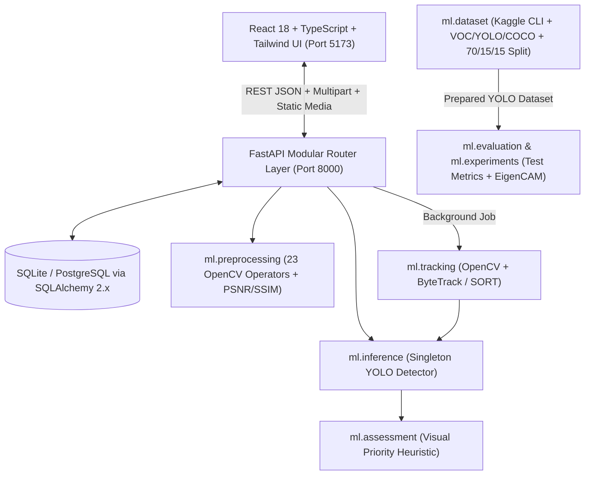

# System Architecture — RoadGuard AI

## Architectural Overview

RoadGuard AI follows a decoupled three-tier architecture in which the **Machine Learning & Computer Vision (`ml/`)** package operates independently of both the **FastAPI Backend (`backend/`)** and the **React + TypeScript Frontend (`frontend/`)**.

---

## Core Design Principles

1. **Strict ML/UI Independence:** Every module inside `ml/` can be imported from CLI scripts, `pytest` suites, or Jupyter/Colab notebooks without starting FastAPI or React.
2. **Singleton Checkpoint Caching & Hot-Reload:** `RoadDamageDetector` loads PyTorch/Ultralytics weights once into GPU/CPU memory under a thread lock and exposes `/api/model/reload` so newly trained checkpoints activate without server downtime.
3. **Defensive Class-Schema Guardrails:** Both the dataset parser and runtime detector validate class names against `{D00, D10, D20, D40}` and refuse to run mislabelled 5-class or 80-class COCO weights silently.
4. **Non-Blocking Video Processing:** `POST /api/analyze/video` validates upload headers and dispatches frame-by-frame inference + tracking to a background worker, updating `progress_pct` in SQLite so the frontend polls `/api/analyze/video/{id}/status` smoothly.
5. **Database Abstraction:** `backend/app/database/session.py` uses SQLAlchemy 2.x ORM with `PRAGMA foreign_keys=ON` for local SQLite (`outputs/roadguard.db`) and switches to PostgreSQL solely by changing `DATABASE_URL` in `.env`.
